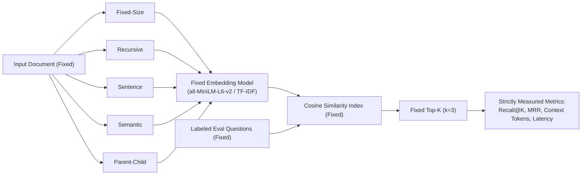

# 🔬 RAG Chunking Experiment Lab

A reproducible, controlled experimental laboratory for benchmarking Document Chunking Strategies in Retrieval-Augmented Generation (RAG) pipelines.

Built with Python and **Streamlit**, this lab provides head-to-head empirical evaluations between **Fixed-Size**, **Recursive**, **Sentence**, **Semantic**, and **Hierarchical Parent-Child** chunking under strictly identical retrieval conditions.

---

## 📑 Table of Contents
1. [Core Features](#-core-features)
2. [Experimental Fairness Guarantee](#-experimental-fairness-guarantee)
3. [Chunking Strategies Supported](#-chunking-strategies-supported)
4. [Measured Metrics vs. Estimated Costs](#-measured-metrics-vs-estimated-costs)
5. [Project Architecture](#-project-architecture)
6. [Quickstart Setup](#-quickstart-setup)
7. [Running the Streamlit Web Application](#-running-the-streamlit-web-application)
8. [Automated Test Suite](#-automated-test-suite)
9. [Reproducible Demo Dataset & Evaluation Suite](#-reproducible-demo-dataset--evaluation-suite)
10. [Export Reports](#-export-reports)

---

## 🚀 Core Features

- **Multi-Format Document Ingestion**: Upload custom `.txt` or `.pdf` files, or use the pre-packaged reproducible technical whitepaper.
- **5 Core Chunking Strategies**:
  - `Fixed-Size` (characters or tokens, configurable chunk size and overlap)
  - `Recursive Character` (hierarchical delimiter cascade: `\n\n`, `\n`, `. `, ` `, `""`)
  - `Sentence Windowing` (grammatical cohesion, N sentences per chunk, overlap)
  - `Semantic Chunking` (embedding similarity breakpoints at percentile valleys)
  - `Hierarchical Parent-Child` (fine-grained child search index + rich parent context delivery)
- **Interactive Chunk Preview & Visualizer**: Inspect generated chunks, token/char counts, syntax badges, and token distribution histograms.
- **Controlled Head-to-Head Benchmarking**: Run all strategies against a fixed evaluation question set simultaneously.
- **Auditable Quality Metrics**:
  - **Recall@K** (Hit Rate@K)
  - **Mean Reciprocal Rank (MRR)**
  - **Precision@K**
  - **Context-Token Consumption**
  - **Measured Latencies**: Chunking time, Indexing time, and Retrieval latency per query.
- **Explicit Measured vs. Estimated Demarcation**: Never fabricate benchmark results. Measured latency and hit rates are strictly separated from formula-based financial cost estimates.
- **1-Click Export**: Download summary tables as CSV, full experiment runs as structured JSON, and query-level logs as CSV.

---

## ⚖️ Experimental Fairness Guarantee

In empirical RAG evaluations, comparing chunking strategies is only valid if all confounding retrieval variables are held constant:



1. **Identical Embedding Model**: All chunks across all compared strategies are embedded using the exact same model (`all-MiniLM-L6-v2` dense neural or `tfidf-dense-local` deterministic).
2. **Identical Dataset**: All strategies operate over the exact same text stream.
3. **Identical Retrieval Metric**: Exact cosine similarity with unit L2 normalization:

$$
\text{Cosine Similarity}(A, B) = \frac{A \cdot B}{\|A\|_2 \, \|B\|_2} = A \cdot B
$$

4. **Identical Top-K**: The number of retrieved context items ($K$) is fixed across all strategies (e.g. $K=3$).

---

## 🧩 Chunking Strategies Supported

| Strategy | Description | Best Suited For | Key Parameters |
| :--- | :--- | :--- | :--- |
| **Fixed-Size** | Slices text into rigid segments of $N$ characters or tokens with $M$ overlap. | Low-compute baselines, fixed token budgets. | `chunk_size`, `chunk_overlap`, `unit` |
| **Recursive** | Traverses delimiters hierarchically (`\n\n` $\rightarrow$ `\n` $\rightarrow$ `. ` $\rightarrow$ space) to preserve paragraphs and headings. | General prose, technical documentation, markdown. | `chunk_size`, `chunk_overlap`, `separators` |
| **Sentence** | Preserves grammatical clauses and coreferential pronouns; groups $N$ sentences with $M$ sentence overlap. | Narrative text, legal contracts, research papers. | `sentences_per_chunk`, `sentence_overlap`, `max_chunk_size` |
| **Semantic** | Calculates cosine distance between adjacent sentence embeddings and splits at similarity valleys. | Multi-topic articles, meeting transcripts, dynamic discussions. | `similarity_threshold`, `threshold_type`, `threshold_percentile` |
| **Parent-Child** | Decouples vector search from context synthesis. Indexes compact child chunks, but retrieves large parent chunks upon match. | Complex multi-hop QA, dense technical manuals, preventing context starvation. | `parent_chunk_size`, `parent_overlap`, `child_chunk_size`, `child_overlap` |

---

## 📊 Measured Metrics vs. Estimated Costs

This lab strictly distinguishes between **MEASURED** runtime values and **ESTIMATED** formula-based financial costs:

### 1. Strictly Measured Metrics (Empirical)

#### • Recall@K (Hit Rate@K)
Proportion of queries where at least one retrieved chunk in Top-K contains the ground-truth target.

$$
\text{Recall}(K) = \frac{1}{|Q|} \sum_{q \in Q} \mathbf{1}(\text{hit in top-}K)
$$

> **Formula:** `Recall@K = (Queries with Target Hit in Top-K) / Total Evaluation Queries`

#### • Mean Reciprocal Rank (MRR)
Average reciprocal rank of the first relevant chunk returned across queries (1/rank, or 0 if no hit in Top-K).

$$
\text{MRR} = \frac{1}{|Q|} \sum_{q \in Q} \frac{1}{\text{rank}_1(q)}
$$

> **Formula:** `MRR = (1 / |Q|) × ∑ (1 / Rank of First Relevant Chunk)`

#### • Precision@K
Average proportion of retrieved chunks in Top-K that contain ground-truth evidence.

$$
\text{Precision}(K) = \frac{1}{|Q|} \sum_{q \in Q} \frac{\text{Relevant Chunks in Top-}K}{K}
$$

> **Formula:** `Precision@K = Total Relevant Chunks in Top-K / (K × Total Queries)`

#### • Context Token Count
Total number of tokens injected into the LLM context across queries (measured via `tiktoken` `cl100k_base`).

#### • Latency Metrics
- **Chunking Latency (ms)**: Wall-clock execution time to segment the document into chunks.
- **Indexing Latency (ms)**: Wall-clock time to generate embeddings and build the vector index.
- **Mean Retrieval Latency (ms)**: Average cosine similarity search latency per query.

---

### 2. Estimated Metrics (Cost Modeling)

#### • Estimated Embedding Ingestion Cost (USD)
One-time embedding cost based on total document tokens and evaluation query tokens:

$$
\text{Cost}_{\text{embed}} = \left( \frac{\text{Total Embedded Tokens}}{1{,}000{,}000} \right) \times \text{Rate}_{\text{embed}}
$$

> **Pricing Assumption:** Default rate is $0.02 / 1M tokens (standard `text-embedding-3-small` tier).

#### • Estimated Context Window LLM Prompt Cost (USD)
Inference prompt cost from passing retrieved context tokens into downstream generative models:

$$
\text{Cost}_{\text{context}} = \left( \frac{\text{Total Retrieved Context Tokens}}{1{,}000{,}000} \right) \times \text{Rate}_{\text{context}}
$$

> **Pricing Assumption:** Default rate is $0.15 / 1M tokens (standard lightweight frontier model prompt tier).

---

## 📁 Project Architecture

```
Chunking Stratagies lab/
├── app.py                      # Streamlit interactive web application
├── requirements.txt            # Dependency specifications
├── pytest.ini                  # Pytest configuration
├── README.md                   # Lab documentation & user guide
├── core/                       # Core modular RAG engine
│   ├── __init__.py
│   ├── chunkers/               # Strategy implementations
│   │   ├── __init__.py
│   │   ├── base.py             # BaseChunker and Chunk dataclass
│   │   ├── fixed_size.py       # FixedSizeChunker
│   │   ├── recursive.py        # RecursiveChunker
│   │   ├── sentence.py         # SentenceChunker
│   │   ├── semantic.py         # SemanticChunker
│   │   └── parent_child.py     # ParentChildChunker (hierarchical)
│   ├── embeddings.py           # Unified embedding provider (MiniLM & TF-IDF)
│   ├── retriever.py            # Cosine VectorIndex & parent-child resolver
│   ├── evaluation.py           # Recall@K, MRR, latency, cost evaluator
│   ├── document_loader.py      # PDF and TXT file parser
│   ├── dataset.py              # Benchmark dataset loaders
│   └── export.py               # CSV and JSON report exporters
├── data/
│   ├── demo_document.txt       # Reproducible technical whitepaper (8 sections)
│   └── demo_evaluation_set.json # 10 labeled ground-truth evaluation questions
└── tests/                      # Automated unit and integration tests
    ├── __init__.py
    ├── test_chunkers.py        # Validates all 5 chunkers & token counts
    ├── test_retriever.py       # Tests VectorIndex & parent resolution
    ├── test_evaluation.py      # Tests Recall@K, MRR & cost math
    └── test_end_to_end.py      # End-to-end benchmark on demo dataset
```

---

## 🛠️ Quickstart Setup

### 1. Prerequisites
- Python 3.10+ (tested on Python 3.11, 3.12, and 3.13)
- Windows, macOS, or Linux

### 2. Environment Setup
```bash
# Navigate to the workspace directory
cd "c:\Users\tharu\books\projects\AI Projects\Chunking Stratagies lab"

# (Optional) Create and activate a virtual environment
python -m venv venv
# Windows:
.\venv\Scripts\activate
# macOS/Linux:
source venv/bin/activate

# Install required dependencies
pip install -r requirements.txt
```

---

## 🖥️ Running the Streamlit Web Application

To launch the interactive lab interface:

```bash
# Recommended (ensures the active Python environment is used):
python -m streamlit run app.py

# Or directly:
streamlit run app.py
```

The application will start locally at `http://localhost:8501`.

### Walkthrough of the 4 Tabs:
1. **📄 1. Document & Evaluation Set**: Inspect the pre-loaded technical whitepaper or upload your own PDF/TXT document. Review the 10 labeled ground truth questions.
2. **⚙️ 2. Strategy Config & Preview**: Select any chunking strategy, customize parameters (chunk size, overlap, similarity cutoffs, parent/child sizes), and inspect the resulting chunks and token length histogram.
3. **🧪 3. Fair Benchmark Lab**: Click **"Run Live Fair Benchmark"** to execute all selected strategies against the evaluation questions with fixed embeddings and Top-$K$. Review the comparison table, Recall@K vs. MRR charts, latency metrics, and inspect query-by-query hit/miss details.
4. **💾 4. Export & Reports**: Export summary comparison CSV, full structured JSON, and granular per-query log CSV.

---

## 🧪 Automated Test Suite

Run the automated test suite with `pytest`:

```bash
python -m pytest
```

Expected output:
```
tests/test_chunkers.py::test_token_counter PASSED
tests/test_chunkers.py::test_fixed_size_chunker PASSED
tests/test_chunkers.py::test_fixed_size_token_unit PASSED
tests/test_chunkers.py::test_recursive_chunker PASSED
tests/test_chunkers.py::test_sentence_chunker PASSED
tests/test_chunkers.py::test_semantic_chunker PASSED
tests/test_chunkers.py::test_parent_child_chunker PASSED
tests/test_end_to_end.py::test_end_to_end_demo_run PASSED
tests/test_evaluation.py::test_is_chunk_relevant PASSED
tests/test_evaluation.py::test_evaluation_pipeline PASSED
tests/test_retriever.py::test_vector_index_search PASSED
tests/test_retriever.py::test_parent_child_retrieval_resolution PASSED

12 passed in ~3.7s
```

---

## 📦 Reproducible Demo Dataset & Evaluation Suite

Located in `data/`:
- `data/demo_document.txt`: An 8-section technical whitepaper covering RAG architectural principles, tokenization effects, delimiter cascades, sentence windowing, cosine distances, and parent-child context injection.
- `data/demo_evaluation_set.json`: 10 ground-truth evaluation questions with specific factual target strings and expected sections:
  1. *Primary mechanical advantage of fixed-size partitioning* (`O(N) linear time`)
  2. *Vector volume increase from chunk overlap* (`15% to 25%`)
  3. *Delimiter cascade in recursive splitting* (`\n\n`, `\n`)
  4. *Hit-rate percentage improvement of recursive over fixed* (`18%`)
  5. *Failure mode of sentence windowing* (`high variance in chunk byte size`)
  6. *Boundary determination in semantic chunking* (`cosine similarity drops below`)
  7. *Relative compute cost of semantic chunking indexing* (`4x to 8x`)
  8. *Indexed element vs prompt element in parent-child chunking* (`child chunks embedded`, `parent context in prompt`)
  9. *Mathematical reduction of cosine similarity under L2 normalization* (`dot product`)
  10. *Definition and formula for Mean Reciprocal Rank* (`1/rank`, `average of reciprocal ranks`)

---

## 📑 Export Reports

The lab supports 3 export formats:
1. **Summary CSV (`rag_chunking_summary_report.csv`)**: Strategy names, Top-K, total chunks, mean chunk tokens, Recall@K, MRR, Precision@K, Total Context Tokens, latencies, and estimated costs.
2. **Detailed JSON (`rag_chunking_detailed_report.json`)**: Machine-readable payload containing strategy configurations, measured results, estimated costs, and per-query retrieval logs.
3. **Query Log CSV (`rag_chunking_query_logs.csv`)**: Row-by-row audit log of every evaluation question across each strategy, recording hit status, first hit rank, reciprocal rank, retrieval latency, and matched target string.
